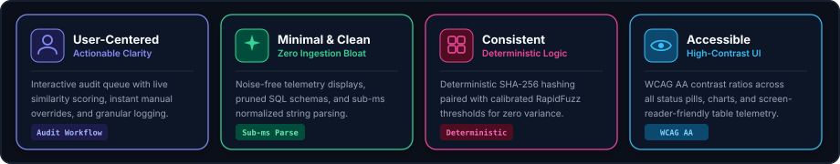
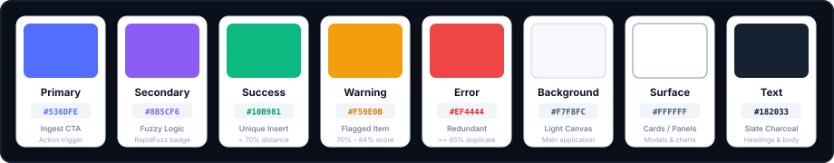

# Design System
### DataPure — Clean. Simple. Productive.

  

This document defines the visual design system, UI components, design tokens, and user experience standards for the **DataPure** enterprise data deduplication and audit platform. The goal is to establish an elegant, modern, minimal interface with consistent styling across telemetry dashboards, ingestion forms, and queue review screens.

---

### 1. Design Principles

  

---

### 2. Color Palette
*Primary colors used across the application, telemetry interfaces, and audit dashboards:*

  

---

### 3. Typography
*We use Inter as the primary interface font and JetBrains Mono for hashes, similarity scores, and code telemetry:*

  <table width="100%" cellpadding="0" cellspacing="0" border="0">
    <tr>
      <td width="90" align="center" style="font-size: 40px; font-weight: 800; background-color: #161B22; color: #818CF8; border: 1px solid #30363D; border-radius: 8px; padding: 8px 12px;">Aa</td>
      <td style="padding-left: 20px;">
        
Inter &amp; JetBrains Mono

        
Primary font family

        
Clean, modern, and highly legible across deduplication diffs, hash digests, and telemetry logs.

      </td>
    </tr>
  </table>

| Role | Font Family | Size / Weight | Usage |
| :-- | :-- | :-- | :-- |
| **Heading 1** | Inter | 24px / 700 Bold | Page headers, main dashboard titles |
| **Heading 2** | Inter | 18px / 600 Semi-Bold | Section headers, card titles |
| **Body Regular** | Inter | 14px / 400 Regular | Paragraphs, documentation text, descriptions |
| **Data / Monospace** | JetBrains Mono | 12px / 500 Medium | SHA-256 hashes, similarity percentages, timestamps |

---

### 4. UI Components & Visual Tokens

#### 4.1 Deduplication Status Badges

| Status | Background | Text Color | Border | Meaning |
| :-- | :-- | :-- | :-- | :-- |
| **UNIQUE** | `#ECFDF5` | `#059669` | `1px solid #A7F3D0` | Non-duplicate record inserted into database |
| **FLAGGED** | `#FFFBEB` | `#D97706` | `1px solid #FDE68A` | Potential duplicate ($70\% \le \text{Score} < 85\%$) queued for review |
| **REDUNDANT** | `#FEF2F2` | `#DC2626` | `1px solid #FECACA` | Exact or high-confidence duplicate ($\ge 85\%$) rejected |

#### 4.2 Telemetry Summary Card

  

    

      Total Ingested Records
      
128,450

    

    

      99.4% Redundancy Catch Rate
      
Avg Latency: <code style="color: #818CF8;">2.4ms</code>

    

  

